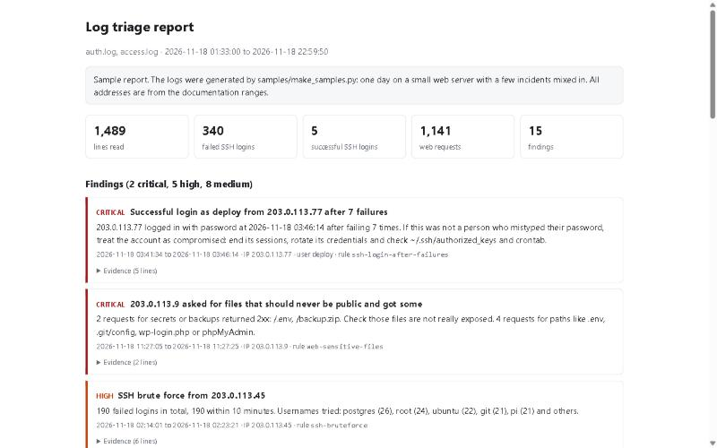

# log-triage

A command-line tool that reads SSH auth logs and web server access logs and tells you what deserves a look: brute force, a login that succeeded after a string of failures, scanners, requests for secret files, injection attempts and bursts of server errors.

**Sample report:** https://siddhanth-mani.github.io/log-triage/ (made from the generated logs in [`samples/`](samples/))



I built it for the first ten minutes after "something looks wrong on the server", when you want the important lines out of a few thousand before deciding what to do next. It is standard-library Python with no dependencies, so it runs on whatever box the logs are on.

```
$ log-triage /var/log/auth.log /var/log/nginx/access.log
Read 1489 lines: 351 auth events, 1141 web requests.
Time span: 2026-11-18 01:33:00 to 2026-11-18 22:59:50
Findings: 2 critical, 5 high, 8 medium

CRITICAL Successful login as deploy from 203.0.113.77 after 7 failures
         203.0.113.77 logged in with password at 2026-11-18 03:46:14 after failing 7 times. If this was
         not a person who mistyped their password, treat the account as compromised: end its sessions,
         rotate its credentials and check ~/.ssh/authorized_keys and crontab.
         2026-11-18 03:41:34 to 2026-11-18 03:46:14   rule: ssh-login-after-failures

CRITICAL 203.0.113.9 asked for files that should never be public and got some
         2 requests for secrets or backups returned 2xx: /.env, /backup.zip. ...

HIGH     SSH brute force from 203.0.113.45
         190 failed logins in total, 190 within 10 minutes. Usernames tried: postgres (26), root (24) ...
```

## Install

Python 3.10 or newer.

```
pip install git+https://github.com/Siddhanth-Mani/log-triage
```

or clone it and run `python -m logtriage` from the folder.

## Usage

```
log-triage FILE [FILE ...] [options]
```

| Option | What it does |
| --- | --- |
| `-f text\|json\|html` | Output format. HTML is a single file with no scripts that you can attach to a ticket. |
| `-o FILE` | Write the report to a file. |
| `--year 2025` | Classic syslog timestamps (`Nov 18 03:14:07`) have no year. Defaults to the current year; a log that crosses from December into January is handled. |
| `--min-severity medium` | Hide findings below this level. |
| `--fail-on high` | Exit with status 2 if anything at this level or above is found, so a cron job or CI step can alert on it. |
| `--ignore 192.0.2.0/24` | Skip your own office, VPN or monitoring addresses. Repeatable. |
| `--ssh-failures 10 --ssh-window 10` | Failed logins within that many minutes that count as brute force. |
| `--web-errors 30 --web-window 5` | 4xx responses within that many minutes that count as a scanner. |
| `--note TEXT` | A line of context under the heading of the HTML report. |

Files can be gzipped (`auth.log.2.gz`), and `-` reads standard input, so `journalctl -u ssh | log-triage -` works. Each line is tried against both formats, so mixed input is fine. Lines that match neither are counted and skipped.

**Exit status:** 0 nothing at or above `--fail-on`, 2 something was found, 1 an error such as an unreadable file.

## What it looks for

| Rule | Severity | Trigger |
| --- | --- | --- |
| `ssh-login-after-failures` | critical | A successful login from an address that failed at least 3 times first. The most important line in most auth logs. |
| `ssh-bruteforce` | high | 10+ failed logins from one address inside 10 minutes. Uses the busiest window, so a slow trickle doesn't trigger it. |
| `ssh-user-enumeration` | medium | One address trying 5+ different usernames, however slowly. |
| `ssh-root-login` | medium | Any direct root login. |
| `sudo-failures` | medium | 3+ failed sudo password checks by one user. |
| `web-sensitive-files` | medium, or critical if served | Requests for `.env`, `.git/config`, backups, SQL dumps, `wp-config.php.bak`, phpMyAdmin and similar. Critical when one of those returned 2xx. |
| `web-scanner` | high | 30+ 4xx responses to one address inside 5 minutes. |
| `web-sqli`, `web-xss`, `web-path-traversal`, `web-command-injection`, `web-log4shell` | medium, or high if any got a 2xx | Known attack patterns in the URL or user agent, after decoding the URL twice (scanners often double-encode). |
| `web-5xx-burst` | medium | 20+ server errors in a single minute. |

Each finding keeps a few of the raw log lines as evidence: the first ones, the last one and a count of what was left out.

Things it does not do: it doesn't block anything (pair it with fail2ban or a firewall for that), it doesn't look up who owns an address, and a clean report doesn't prove nothing happened. It only means none of these patterns showed up.

## Formats understood

- OpenSSH and sudo lines in `auth.log` / `secure`, with the classic syslog timestamp or the RFC 3339 one that newer rsyslog and journald write. `message repeated N times` lines are expanded.
- nginx and Apache access logs in the common or combined format, including escaped quotes in user agents and junk request lines from TLS probes.

Times are reported as written in the logs, which is normally the server's local time.

## Tests

```
python -m unittest discover -s tests -t .
```

31 tests cover the parsers (both timestamp styles, IPv6, repeated-message lines, malformed input, year rollover), every rule including the cases that must not fire (a slow trickle of failures, a success from a different address, ordinary URLs that happen to contain words like "union" or "select"), HTML escaping of hostile log content, and the command line. GitHub Actions runs them on Python 3.10, 3.12 and 3.13.

`python samples/make_samples.py` regenerates the sample logs. They are seeded, so the output is the same each time, and every address in them is from the documentation ranges (192.0.2.0/24, 198.51.100.0/24, 203.0.113.0/24).

## Licence

MIT
